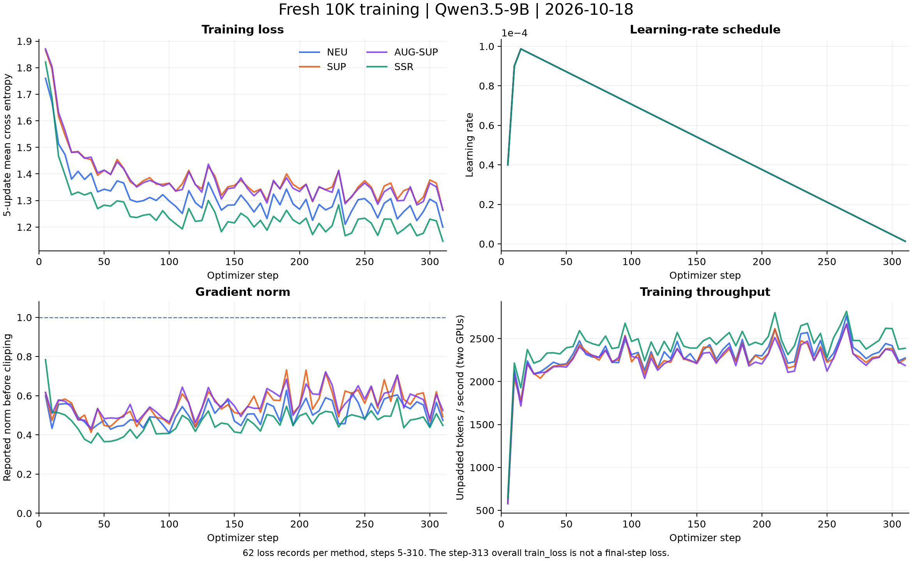
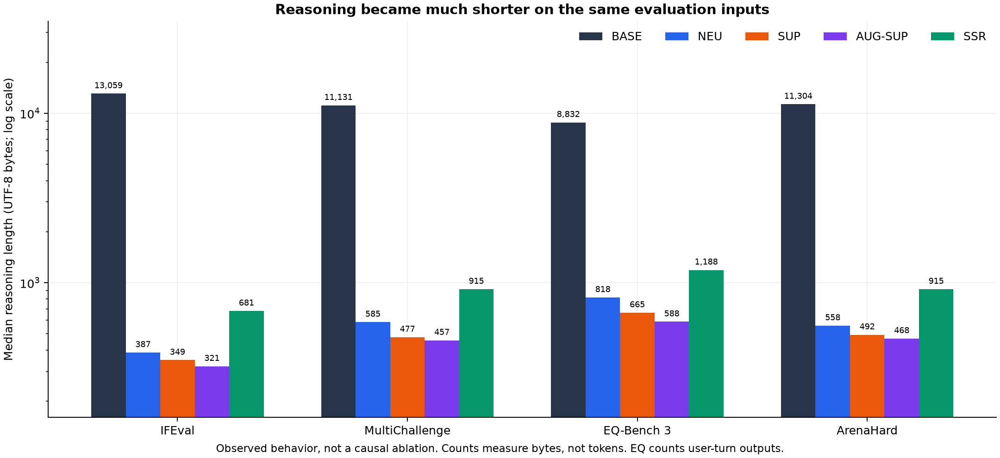
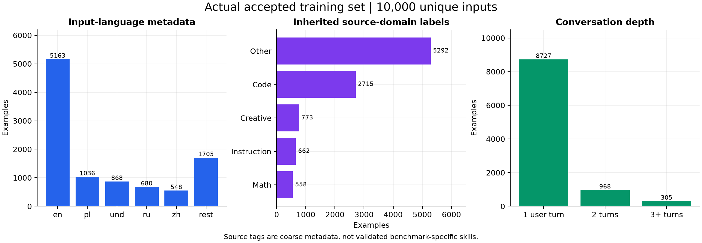

# 首批10K四方法9B训练复盘

核查日期：2026-10-25。训练日期：2026-10-18。评测于2026-10-24核验完成。作者：张瑞鹏（ZrpChuang）。

## 结论

**目前最强的解释线索是训练目标把模型的推理过程压成了短篇事后说明，并伴随可测量的约束遵循能力下降。训练数值收敛，尚未找到已证实的mask、截断或聊天模板实现错误。**

已确认的事实与原因假设需要分开：目标构造、SSR结构偏差、缺少验证集都是事实；它们各自造成多少分数下降，以及学习率的贡献，仍需固定开发集上的单变量实验。现有证据不支持直接把问题归因于10K数据太少。

本次只读取产物、运行CPU统计与编码检查、生成图表；没有重训、生成新数据、改动冻结评测或停止GPU任务。

## 0. 已核验的测试结果

训练于2026-10-18完成；评测于2026-10-24完成核验。数据来自[最终核验记录](evidence/training/final_verification.json)。

| 方法 / Qwen3.5-9B | IFEval | MultiChallenge | EQ-Bench 3 | ArenaHard |
|---|---:|---:|---:|---:|
| BASE | 90.76 | 55.31 | 30.80 | 12.64 |
| NEU | 67.65 | 27.11 | 30.87 | 3.41 |
| SUP | 66.54 | 27.11 | 33.02 | 4.72 |
| AUG-SUP | 67.10 | 30.04 | 32.48 | 4.14 |
| SSR | 64.70 | 24.18 | 31.89 | 3.19 |

均为本地冻结协议：IFEval题级严格通过率（541题）、MultiChallenge裁判通过率（273题）、EQ本地rubric（45题），Arena主指标为500道hard prompt的加权胜率，完整评分保存750题。EQ/Arena不能当作官方排行榜分数。BASE复用同协议已核验结果。四训练、16项评分、四方法独立核验及W&B同步完成，不代表100K或整个研究完成。

## 1. 训练曲线



| 方法 | 步数 | 首个loss（step 5） | 最后一个窗口loss（step 310） | 已记录最大grad norm | 全程平均train_loss |
|---|---:|---:|---:|---:|---:|
| NEU | 313 | 1.7599 | 1.1998 | 0.6279 | 1.3173 |
| SUP | 313 | 1.8656 | 1.2631 | 0.7316 | 1.3863 |
| AUG-SUP | 313 | 1.8706 | 1.2640 | 0.7223 | 1.3818 |
| SSR | 313 | 1.8214 | 1.1465 | 0.7845 | 1.2549 |

- 每种方法有63条日志：62个每5步记录的loss窗口，加1条step 313全程总结。图中没有把总结的`train_loss`误画成最后一步loss。
- loss整体下降，后半程有批次噪声；所有已记录指标有限，已记录梯度范数没有超过裁剪阈值1.0。没有数值发散证据。
- 学习率约10步warmup至1e-4，随后线性下降。每种方法训练约66–67分钟，双卡，总batch32，每卡batch1、累积16，1 epoch，LoRA r16/alpha32/dropout0.05。
- **没有验证loss曲线。** `TrainingArguments(eval_strategy="no")`，也没有提供`eval_dataset`。仅凭训练loss下降不能判断过拟合、原有能力保持或最佳停止点。
- SSR的训练loss最低，但测试表现并不好。四个目标的文本长度、重复结构和可预测性不同，不能直接用训练loss对方法质量排序。

W&B（四个run均已核验313步同步）：[NEU](https://wandb.ai/zrpchuang-south-china-university-of-technology/cot-analyse/runs/9fbc67ac563a3f479851)、[SUP](https://wandb.ai/zrpchuang-south-china-university-of-technology/cot-analyse/runs/7f204b7854f56ccabd38)、[AUG-SUP](https://wandb.ai/zrpchuang-south-china-university-of-technology/cot-analyse/runs/e402b9d208170f0015d0)、[SSR](https://wandb.ai/zrpchuang-south-china-university-of-technology/cot-analyse/runs/e5c9e5202b40ca41dd7a)。

## 2. 按优先级排列的发现

### P1：短篇说明被作为完整的thinking监督目标

证据：[data.py:307](https://github.com/ZrpChuang/CoT_Gen/blob/4788f87301ae082490f8cca7f341f4156ef8a0c2/auto_research/scaling/core/data.py#L307)、[common.py:311](https://github.com/ZrpChuang/CoT_Gen/blob/4788f87301ae082490f8cca7f341f4156ef8a0c2/auto_research/scaling/core/common.py#L311)。生成要求明确限制为通常2–5句、至多200词的公开解题说明；随后训练序列为：

```text
原生对话模板 + <think>
短篇解题说明
</think>
共享GPT答案 + <|im_end|>
```

四方法训练目标的thinking长度中位数分别为 **100、80、75、164 token**。这是一种很强的短说明监督，并不等价于教模型完成复杂问题的可验证推导。

同一批评测输入上的行为变化也很明显：



以IFEval为例，推理内容中位数从BASE的 **13,059 UTF-8字节**，降至NEU **387**、SUP **349**、AUG-SUP **321**、SSR **681**；相当于减少约19–41倍。图中统计的是字节，不是token。

抽读的失败例子显示：模型经常在说明中说“检查关键词”“限制大写词个数”“加入分隔符”，最终答案却没有执行这些检查。这说明它学到了描述解题计划的写法，未可靠地落实约束。**短说明监督与这个行为变化一致；尚无消融实验确定因果贡献。**

### P1：当前四方法提示词与原论文存在实质差异，SSR尤其明显

证据：[生成策略](https://github.com/ZrpChuang/CoT_Gen/blob/4788f87301ae082490f8cca7f341f4156ef8a0c2/auto_research/scaling/core/data.py#L292)、[全量SSR结构统计](evidence/checks/ssr_structure.json)。

本轮10,000条SSR中：

- 2步1,616条，3步6,102条，4步2,240条，5步42条；没有6步及以上样本。
- 30,708个功能标签里，PLAN为30,195个，占 **98.33%**。
- EVAL仅254个，INFR仅54个，BRCH仅2个；RFLX、BTRK为0。
- `[HIGH]/[LOW]`标记为0；10,000条reason部分全部只有1段。

所附论文附录F（PDF第34–35页）的SSR模板要求6–12步、功能/重要性标记、与骨架对应的逐步段落；本轮提示词把这些要求替换成了简短计划与概述。NEU/SUP/AUG-SUP也使用了新的短说明模板，AUG-SUP的干预强度与原文不同。因此当前成绩反映的是**GPT短说明改编方案**，不能按方法同名就解释为原文复现结果。

SSR-D教师训练及蒸馏没有在本轮四方法执行范围内，也不能直接拿SSR-D的论文成绩作等价目标。

### P1：训练过程缺少独立的能力保持验收

证据：[train.py:518](https://github.com/ZrpChuang/CoT_Gen/blob/4788f87301ae082490f8cca7f341f4156ef8a0c2/auto_research/scaling/core/train.py#L518)。训练只计算训练目标loss，验证策略为no，没有训练中的开发集检查。完成判断主要是步数、文件完整性、有限值及数据来源；这些不能发现能力下降。

建议新增与测试集隔离、预先冻结的开发集，覆盖可执行格式约束、多轮记忆、可验证代码/数学及自然对话，记录训练前和训练中的能力保持情况。不要根据这四个测试集的分数选择checkpoint。

### P1：数据是可读的泛对话，但不是经过程序验证的推理金标

证据：[data.py:582](https://github.com/ZrpChuang/CoT_Gen/blob/4788f87301ae082490f8cca7f341f4156ef8a0c2/auto_research/scaling/core/data.py#L582)、[全量统计](evidence/checks/data_statistics.json)、[抽样评价](SAMPLES.md)。

- 随机种子20261025抽读24组共同输入/答案和NEU说明，其中前8组对照四方法说明；另外定向检查3组格式约束样本。共27组训练输入、48份随机样本方法说明，并阅读5组BASE成功/NEU失败的评测对照。
- 回答总体流畅，部分会主动披露不确定性；未发现足以声称“全是脏数据”的证据。抽样数学题`3**1000`数字和经CPU计算确为2142。
- 但问候、地点说明、一般咨询也强制配上解题说明，推理信息量低。诗词格律、小说细节、产品能力等大多没有独立oracle。
- **3,550/10,000**条被模型自审标记`uncertain_external_facts=true`，其中部分带具体未核实事项，仍可通过。该标记不等于回答错误，但表明“合格”不等于已验证正确。
- 同一GPT负责答案、四方法说明及质量审核。审核没有代码执行、形式约束检查或数学验证流程；相关错误可能共同通过。

### P1：已有低学习率对照未纳入本轮配方决策

本轮实际LR为 **1e-4**，而所附论文表20为4e-5；本轮batch32、warmup0.03、长度8K、1 epoch、10K数据、LoRA，与论文batch256、warmup0.01、32K、最多4 epoch、100K和其训练框架不同。模型家族也从论文Qwen3-8B改为Qwen3.5-9B。

旧实验已经有实际学习率对照，见[原始对照记录](evidence/training/historical_lr_control.md)：

| 历史9B NEU，同4,175条输入与其他设置 | IFEval | MultiChallenge | EQ | Arena |
|---|---:|---:|---:|---:|
| LR1e-4 | 73.38 | 33.70 | 36.96 | 3.01 |
| LR1e-5 | 81.15 | 39.93 | 31.76 | 11.72 |

该对照已证明**历史数据上更新幅度会明显影响退化程度**，但1e-5也未全面恢复BASE。当前数据和教师与旧实验不同，不能把历史增益直接外推到本轮10K，也不能据此证明推理变短是因果。

本轮仍继承1e-4，未先验证这条已知风险，也没有设置能力保持门禁，这是配方决策与验收流程的问题。学习率应作为当前数据上的优先单变量诊断，不能简单把历史对照再说成“尚未做过”。

## 3. 全量数据分布及质量判断



| 项目 | 实测 |
|---|---:|
| 共同独立输入 | 10,000 |
| 四方法输入、共享答案逐项对齐 | 通过 |
| 重复完整输入上下文 | 0 |
| 重复答案文本 | 42条超出唯一答案数；可能来自问候等常见回答 |
| 英文语言标签 | 51.63% |
| 波兰语 / 俄语 / 简体中文标签 | 10.36% / 6.80% / 5.48% |
| 单轮 / 两轮 / 三轮及以上 | 87.27% / 9.68% / 3.05% |
| 源标签other / code / creative / instruction / math | 52.92% / 27.15% / 7.73% / 6.62% / 5.58% |
| 空答案、空cot、特殊控制标签混入 | 均为0 |

源标签是粗粒度元数据：样本6949被标为code，内容实际是社会议题；样本7269是Windows故障排查。不能把27.15%的code标签直接当成可执行编程训练占比。

LMArena泛对话来源本身并非错误，论文也使用该来源。这里的具体不足是：没有任务配额、标签粗糙、绝大多数输入单轮、缺少目标能力的分层质量验收。尚不能把语言/领域配比单独定为退化主因。

## 4. 评测失败具体表现

NEU在IFEval的541题中：BASE通过491题，NEU通过366题；**133题由通过变失败，8题由失败变通过**。

| 约束类型 | BASE通过 / 总数 | NEU通过 / 总数 |
|---|---:|---:|
| 字母次数 | 28/33 | 11/33 |
| 首尾引号 | 41/41 | 25/41 |
| 关键词次数 | 39/42 | 28/42 |
| 禁用词 | 48/49 | 37/49 |
| 句子数 | 51/52 | 40/52 |

例子：

- ID1012要求先逐字重复请求、前面不能添加字符；NEU额外包了一对引号，导致失败。
- ID1040要求大写词少于10个；NEU的说明声称控制为6个，但最终把姓名、标题、栏目等大量内容大写。
- ID1069要求包含两个关键词；说明提到要包含，正文却漏了关键词。
- ID1082要求用`***`分隔两段；说明提到分隔符，正文没写。
- ID1000的NEU回答选择披露无法访问网页、提供占位模板，字数等约束失败；BASE虽满足形式约束，传记内容却有明显可疑叙述。**IFEval验证格式遵循，不验证事实正确性，不能把其高分等同于语义质量。** 前四类失败则直接反映约束落实能力。

## 5. 训练脚本及token链路检查

| 检查 | 结果与范围 |
|---|---|
| 从原始基座新建LoRA | 四份完成记录parent=null；代码fresh_base保护存在 |
| Loss mask | 前缀labels=-100，仅最终cot、答案和结束符受监督；padding labels=-100，attention=0 |
| 完整序列及截断 | 全量40,000条编码序列无超过8192、无缺失思考结束符/消息结束符；各方法最大8079/8062/8057/8137 |
| 编码缓存与实际构造 | 随机24输入×4方法共96条与native_pack一致 |
| 原生聊天模板 | 同96条对照原生完整模板一致，忽略模板末尾格式换行；此前诊断误把新版API的mapping当list，已更正 |
| 合并模型tokenizer | 词表、special IDs一致；96条编码、解码一致；模板文件哈希一致。JSON序列化哈希不同不代表语义变化 |
| RoPE/架构配置 | 规范化后的比较未发现RoPE参数变化；差异主要为dtype、cache、路径及根级特殊token默认值 |
| 梯度累计 | 2卡×每卡1×16=32；所装模型accepts_loss_kwargs=False，Trainer会进行累计归一化，未发现16倍loss放大依据 |
| 损失加权 | 当前每卡batch1，按样本平均token CE再累计，短样本每个token的相对权重较高；这属于目标函数选择，不是漏mask |
| 合并与保存 | 代码使用merge_and_unload、保存tokenizer与generation_config；本次未重载9B执行合并前后logit等价检查 |

检查基于本次部署源码及已装Transformers5.12.1、PEFT0.20.0。没有运行9B前向、重训或GPU数值等价实验；不能据此排除全部内核或权重数值问题。

## 6. 建议的下一步

1. **先建立开发集验收。** 用训练外、测试外的固定样本记录BASE能力、形式约束通过率、多轮记忆、事实/代码/数学可验证项；后续只依据该开发集做方案选择。
2. **修正说明生成目标。** 复杂任务需要可核查的中间步骤、条件、结果与检查；普通问候可采用轻量目标。SSR按明确选定的论文版本实现骨架、功能区分与逐步解释，并做格式/内容自动验证。
3. **先在NEU上做小对照。** 保持输入/答案及其他训练设置一致，先比较原LR和较低LR；再单独比较现有短说明与经过验证的任务推导目标。数据量、长度、监督token数和GPU小时均记录，避免一次改动多个变量。
4. **验证后再决定扩大规模。** 当前结果不支持直接延长这套监督目标。测试集只在配方固定后做最终验收，不用于挑checkpoint。

这些是后续实验建议，本次未启动执行。

## 7. 文件与复现

本Git版本在2026-10-26整理，保留统计数值、曲线和结论；移除了原始对话、回答、自审文本、论文全文及机器绝对路径。原始私有审计包保持不变。

- [README.md](README.md)：目录、来源和复现命令。
- [SAMPLES.md](SAMPLES.md)：逐样本人工评价摘要，不含原始对话。
- [figures/](figures/)：三张图的PNG与可编辑SVG。
- [evidence/training/](evidence/training/)：曲线数值、脱敏训练配置、版本、历史LR对照及终评核验。
- [evidence/checks/](evidence/checks/)：全量统计及CPU检查的聚合结果。
- [manifest.json](manifest.json)：已备份文件SHA256、原始证据指纹、受审源码的固定提交链接。
- [review.py](review.py)：从保存的统计重绘三张图；不重新运行全量数据或模型检查。

原始产物标识：`CoT_Analyse_artifacts/gpt_fresh_100k_20261012`，完整私有复盘包位于其`reports/reviews/2026-10-25_10k_training/`；实际物理挂载路径不纳入Git。

论文依据为用户附件`01_SSR-D_2602.14469.pdf`（arXiv标识2602.14469），读取第4–5、30、33–35页；参数表及SSR提示词页已视觉核对。讨论针对该附件版本，Git不附论文全文。
